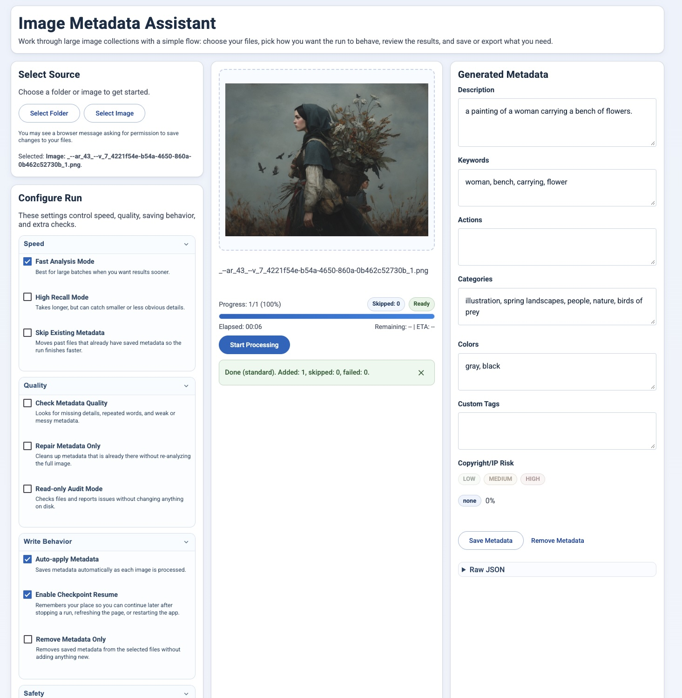

# Image Metadata Assistant

Browser app + CLI for adding searchable image metadata in-place.



The app analyzes images and stores metadata directly in the image file so other tools can sort/search by:
- description
- keywords (objects)
- actions
- colors
- categories
- custom tags

## What This App Is

This project provides:
- A browser UI (`web_app.py`) for selecting images/folders, reviewing metadata, optionally editing, and saving.
- A CLI (`image_describer_app.py`) for batch processing folders.

It writes metadata into PNG/JPEG/TIFF/WEBP files in-place.

## Privacy and Safe Use

This is a local, single-user tool. Keep the server bound to `127.0.0.1`;
do not expose it through a public host, reverse proxy, or tunnel. The API has
no authentication and can read and modify images selected on the local machine.
The built-in Flask debugger is disabled.

Back up images before writing metadata: writes modify the original files.
Image analysis uses locally loaded models; the first run downloads model weights
from Hugging Face. The browser UI also loads fonts and UI components from Google
Fonts and esm.run, so it requires external requests and is not fully offline.

Local resume state contains selected file/folder paths. `.gitignore` excludes it,
virtual environments, credentials, screenshots, recordings, and historical
snapshots. Keep private images and exports outside the project folder. Ignore
rules do not remove files that were already committed; inspect existing Git
history before publishing a previously used repository.

## Install

Prerequisites:

- The existing environment was smoke-tested on macOS (Apple Silicon) with Python
  3.9.6. Other Python versions and operating systems have not been verified.
- A desktop session is needed for native file/folder pickers. The browser app uses
  AppleScript on macOS and Tkinter on other platforms; the CLI folder picker
  requires Tkinter. CLI `--folder` usage does not require a picker.
- Node.js is needed only for `qa.sh` JavaScript syntax checks (checked with
  Node.js 24.11.0).
- Model weights download on first use and require disk space and internet access.

```bash
python3 -m venv .venv
source .venv/bin/activate
pip install -r requirements.txt
```

To use the direct dependency versions installed in the smoke-tested environment:

```bash
pip install -r requirements.txt -c constraints-smoke-tested.txt
```

The constraints record installed versions, not a complete dependency lock or a
fresh-install validation. Transitive dependencies remain unpinned, and full model
inference has not been revalidated as part of this repository cleanup.

## Start The App

Run:

```bash
python web_app.py
```

Open:
- [http://127.0.0.1:8080](http://127.0.0.1:8080)

One-line restart:

```bash
./restart_web_app.sh
```

The restart helper requires Bash, `pgrep`, `pkill`, and a project-local `.venv`;
it is intended for macOS/Linux shells. On Windows, activate the environment with
`.venv\Scripts\activate` and start `python web_app.py` directly. Windows and Linux
behavior have not been tested.

Run QA checks:

```bash
./qa.sh
```

## Quick Start

1. Click `Select Folder` or `Select Image` (or drag/drop images into the Current Image area).
2. Choose `Description Model` and `Object Detection Model`, then set options (toggles).
3. Click `Start Processing`.
4. Review/edit metadata in the right panel.
5. Click `Add Metadata` (or let auto-apply write it).

## Main UI Areas

### Current Image
- Shows the current file preview.
- `Start Processing` starts or stops a run.

### Generated Metadata
- Editable fields:
  - `Description`
  - `Keywords` (objects)
  - `Actions`
  - `Custom Tags`
  - `Categories`
- `Colors` is editable.
- `Copyright/IP Risk` is generated/read-only output.
- `Add Metadata` writes metadata for the current image immediately.
- `Raw JSON` shows the metadata payload that is saved.

## Model Selection (What To Use When)

The controls row includes:
- `Description Model`
- `Object Detection Model`

Available model choices:
- Description:
  - `BLIP Base (Balanced)` (`Salesforce/blip-image-captioning-base`)
  - `BLIP Large (More Detail, Slower)` (`Salesforce/blip-image-captioning-large`)
- Object detection:
  - `OWL-ViT Base (Balanced)` (`google/owlvit-base-patch32`)
  - `OWL-ViT Large (Higher Recall, Slower)` (`google/owlvit-large-patch14`)
  - `Disabled (Description Keywords Only)` (`none`)

Recommended scenarios:
- Best throughput for very large batches:
  - `BLIP Base` + `OWL-ViT Base`
  - `High Recall Mode` OFF
  - `Fast Analysis Mode` ON
- Better detail on stylized/fantasy art:
  - `BLIP Large` + `OWL-ViT Large`
  - `High Recall Mode` ON
- Lowest compute / fastest startup:
  - `BLIP Base` + detector `Disabled`
  - Useful when description quality matters most and object recall is less important.
- Default balanced behavior:
  - `BLIP Base` + `OWL-ViT Base`

Notes:
- The first image after changing models is slower while the selected model loads.
- If an invalid model ID is sent, the backend falls back to default model IDs.
- If a valid model cannot be loaded in your environment, analysis returns an error for that run.

### Progress + Status
- Shows run progress, elapsed time, remaining time, and ETA.
- Displays checkpoint/resume information when available.

### Queue Filter
- Build an index of embedded metadata and filter/reorder queue before processing.

### Live Log
- Real-time processing events and timing summaries.

## Options (What Each Toggle Does)

### `Automatically add metadata without confirmation`
- ON: writes metadata immediately after analysis/check.
- OFF: pauses on each image and waits for confirmation.

### `Skip images that already have keywords`
- If an image already has embedded keywords/objects, it is skipped quickly.
- Best option for speeding up reruns/resume.

### `High Recall Mode (slower, better small object detection)`
- Uses heavier inference path to catch smaller/harder objects.
- Improves recall but is slower.

### `Check metadata quality (fast, includes missing metadata)`
- Runs a fast metadata repair/check pass:
  - fixes obvious description/keyword/action/category/color issues
  - fills missing metadata when possible
- With recent safeguards, writes only happen when a material change exists.

### `Repair metadata only (no full image analysis)`
- No full vision analysis.
- Only checks/repairs existing metadata.
- Auto-enables `Check metadata quality`.

### `Read-only audit mode (no file writes)`
- Runs checks and reports issues/missing fields.
- Never writes files.
- Auto-enables `Check metadata quality`.

### `Detect duplicate / near-duplicate images`
- Computes perceptual hashes and flags duplicates in QC findings/log.
- Adds duplicate indicators to metadata when writing is enabled.

### `Copyright/IP risk check (flags only)`
- Fast text-term risk pass using description/keywords/categories/tags.
- Produces risk `level`, `score`, and `matches`.

### `Auto-restore + resume after refresh/restart`
- Enables checkpoint-based restore/resume behavior.
- Current behavior: restore is triggered when `Start Processing` is clicked.
- If no selection is loaded and a checkpoint exists, `Start Processing` can restore the previous session.

## Queue Filter Options

### `Index Metadata`
- Reads metadata from selected files into memory for filtering.

### `Keyword contains`
- Matches description + keywords + actions + custom tags.

### `Category contains`
- Filters by category text.

### `Color contains`
- Filters by generated color labels.

### `Missing metadata only`
- Keeps files that have missing required fields.

### `Low confidence first`
- Reorders results so lower-confidence metadata appears first.

### `Apply Queue Filter`
- Applies current filter controls to active queue.

### `Clear Filter`
- Restores full selected queue.

## Checkpoint/Resume Behavior

- The app stores run checkpoint info in browser storage.
- On interruption/crash/server restart, it can continue from the last saved index.
- `Stop Processing` preserves checkpoint for resume.
- Resume details show source mode, last update time, and next item.

## Metadata Storage Format

### PNG
Writes PNG text fields including:
- `ImageDescriberMetadata` (JSON blob)
- `Description`
- `Subject`
- `Keywords`
- `Comment`
- `Objects`
- `Actions`
- `Colors`
- `CustomTags`
- `Categories`

### JPEG/TIFF/WEBP
Writes EXIF fields including:
- `ImageDescription`
- `XPTitle`
- `XPSubject`
- `XPKeywords`
- `XPComment`
- `UserComment` (JSON payload)

## CLI Usage

Folder picker:

```bash
python image_describer_app.py
```

Direct folder:

```bash
python image_describer_app.py --folder "/path/to/images"
```

## Performance Tips

For fastest large-batch processing:
- Keep `High Recall Mode` OFF.
- Keep `Detect duplicate / near-duplicate images` OFF unless needed.
- Keep `Copyright/IP risk check` OFF unless needed.
- Keep `Check metadata quality` OFF unless you are doing repair/QC.
- Keep `Skip images that already have keywords` ON for reruns.

## Troubleshooting

### `ModuleNotFoundError: No module named 'flask'`
Install dependencies in your virtual environment:

```bash
source .venv/bin/activate
pip install -r requirements.txt
```

### `File picker already active`
Close the currently open picker and retry selection.

### Browser asks for save permission or denies in-place write
Re-select files using `Select Folder`/`Select Image` and grant write permission when prompted.

### How to verify metadata was written
Re-load the same image in the app and inspect `Raw JSON`, or inspect metadata with external EXIF/PNG metadata tools.

## License

Copyright (c) 2026 Michael Davis. All rights reserved.

No open-source license is granted for this project's code or documentation.
Third-party libraries, model weights, and other third-party assets remain subject
to their respective licenses and terms.
